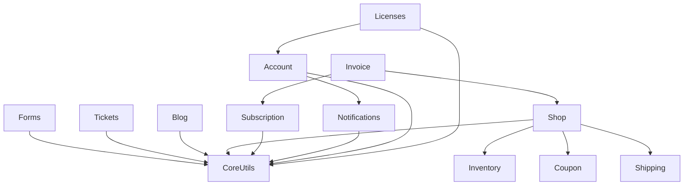

# نقشه راه مهاجرت ماژول‌ها (Module Migration Roadmap)

> **آخرین به‌روزرسانی:** 1405/03/03  
> **وضعیت:** در حال اجرا  
> **مسئول:** تیم توسعه پلتفرم

---

## فازبندی کلی

| فاز | عنوان | وضعیت | ماژول‌ها |
|-----|-------|--------|----------|
| **فاز 0** | معماری و قوانین | ✅ کامل | - |
| **فاز 1** | ماژول‌های هسته (P1) | 🔄 در حال اجرا | Forms, Tickets |
| **فاز 2** | ماژول‌های اصلی (P2) | ⏳ آماده | Blog, Shop, Pages, Menus |
| **فاز 3** | ماژول‌های پیشرفته (P3) | ⏳ آماده | Notifications, Account, Licenses |
| **فاز 4** | ماژول‌های تخصصی (P4) | ⏳ آماده | 22 ماژول باقی‌مانده |

---

## فاز 1: ماژول‌های هسته (Priority 1)

### 1.1 Forms ✅ (در حال تکمیل)

| مرحله | توضیح | وضعیت |
|-------|-------|--------|
| پکیج پایه | ایجاد پکیج با Controller, Service, Repository, Contract | ✅ کامل |
| پنل ادمین | CRUD فرم‌ها، فیلدها، انتساب به سایت | ✅ کامل |
| فرانت‌اند عمومی | نمایش و ارسال فرم‌ها با کپچا | ✅ کامل |
| نصب در customer-site | نصب پکیج و حذف کدهای دستی | 🔄 در حال اجرا |
| نصب‌کننده | دستور artisan برای نصب خودکار | ✅ کامل |

**فایل‌های پکیج:**
- `packages/saas-platform/modules/forms/`
- مسیر namespace: `SaaSPlatform\Modules\Forms`
- Provider: `FormsServiceProvider`
- Command: `php artisan forms:install`

### 1.2 Tickets 🔄 (در حال برنامه‌ریزی)

| مرحله | توضیح | وضعیت |
|-------|-------|--------|
| پکیج پایه | Controller, Model, Service | ⚠️ ناقص |
| Repository | ایجاد FormRequest و Repository | ⬜ انجام نشده |
| Contract | ایجاد Interface برای Service و Repository | ⬜ انجام نشده |
| Views | ایجاد Blade views کامل | ⬜ انجام نشده |
| Frontend | فرانت‌اند عمومی تیکت‌ها | ⬜ انجام نشده |
| Installer | دستور نصب خودکار | ⬜ انجام نشده |

**فایل‌های پکیج:**
- `packages/saas-platform/modules/tickets/`
- مسیر namespace: `SaaSPlatform\Modules\Tickets`

---

## فاز 2: ماژول‌های اصلی (Priority 2)

### 2.1 Blog
- **وضعیت:** ⬜ شروع نشده
- **فایل‌های موجود در customer-site:**
  - Controllers: `Front\BlogController`, `Admin\PostController`, `Admin\CategoryController`, `Admin\PostSeriesController`
  - Models: `Post`, `Category`, `PostSeries`
  - Views: `blog/*`, `admin/posts/*`, `admin/categories/*`, `admin/post-series/*`
  - Routes: `module:blog` middleware
- **پکیج:** `packages/saas-platform/modules/blog/`

### 2.2 Shop
- **وضعیت:** ⬜ شروع نشده
- **فایل‌های موجود در customer-site:**
  - Controllers: `Front\ShopController`, `Admin\ProductController`, `Admin\ProductAttributeController`, `Admin\ProductCategoryController`, `Admin\OrderController`, `Admin\ShopProductReviewController`, `Admin\CouponController`
  - Models: `Product`, `ProductAttribute`, `ProductCategory`, `Order`, `Coupon`, `ProductReview`
  - Views: `shop/*`, `admin/products/*`, `admin/orders/*`, `admin/coupons/*`
  - Routes: `module:shop` middleware
- **پکیج:** `packages/saas-platform/modules/shop/`

### 2.3 Pages
- **وضعیت:** ⬜ شروع نشده
- **فایل‌های موجود در customer-site:**
  - Controllers: `Front\PageController`, `Admin\PageController`, `Front\PageBuilderController`
  - Models: `Page`
  - Views: `page/*`, `admin/pages/*`, `builder/*`
  - Routes: `page.show`, `builder.*`
- **پکیج:** `packages/saas-platform/modules/pages/`

### 2.4 Menus
- **وضعیت:** ⬜ شروع نشده
- **فایل‌های موجود در customer-site:**
  - Controllers: `Admin\MenuController`, `Api\SiteMenuApiController`
  - Models: `Menu`, `MenuItem`
  - Views: `admin/menus/*`
  - Routes: `admin.menus.*`, `site-api.menus`
- **پکیج:** `packages/saas-platform/modules/menus/`

---

## فاز 3: ماژول‌های پیشرفته (Priority 3)

### 3.1 Notifications
- **وضعیت:** ⬜ شروع نشده
- **فایل‌های موجود در customer-site:**
  - Controllers: `Admin\NotificationController`, `Admin\SiteNotificationController`, `Account\NotificationController`
  - Models: `Notification`, `SiteNotification`
  - Views: `admin/notifications/*`, `account/notifications/*`
- **پکیج:** `packages/saas-platform/modules/notifications/`

### 3.2 Account (Dashboard کاربران)
- **وضعیت:** ⬜ شروع نشده
- **فایل‌های موجود در customer-site:**
  - Controllers: 9 کنترلر در `Account\`
  - Views: `account/*`
  - Routes: `account.*`
- **پکیج:** `packages/saas-platform/modules/account/`

### 3.3 Licenses
- **وضعیت:** ⬜ شروع نشده
- **فایل‌های موجود در customer-site:**
  - Controllers: `Admin\LicenseController`, `Admin\ModuleController`, `Admin\ModuleChangeLogController`, `Admin\ModuleStoreController`
  - Models: `License`, `Module`
  - Views: `admin/license/*`, `admin/modules/*`, `admin/module-store/*`
- **پکیج:** `packages/saas-platform/modules/licenses/`

---

## فاز 4: ماژول‌های تخصصی (Priority 4)

| ردیف | ماژول | slug | وضعیت |
|------|-------|------|--------|
| 1 | Accounting | accounting | ⬜ |
| 2 | Advertisements | advertisements | ⬜ |
| 3 | Advanced Search | advanced_search | ⬜ |
| 4 | Analytics | analytics | ⬜ |
| 5 | Announcements | announcements | ⬜ |
| 6 | Backup | backup | ⬜ |
| 7 | Brand | brand | ⬜ |
| 8 | Business Card | business_card | ⬜ |
| 9 | Captcha | captcha | ⬜ |
| 10 | Cloud | cloud | ⬜ |
| 11 | Contact | contact | ⬜ |
| 12 | Contract | contract | ⬜ |
| 13 | Courses | courses | ⬜ |
| 14 | CRM | crm | ⬜ |
| 15 | Currency Reform | currency_reform | ⬜ |
| 16 | Discount Advanced | discount_advanced | ⬜ |
| 17 | Gallery | gallery | ⬜ |
| 18 | i18n | i18n | ⬜ |
| 19 | Inventory | inventory | ⬜ |
| 20 | Invoice | invoice | ⬜ |
| 21 | Marketing Automation | marketing_automation | ⬜ |
| 22 | Marketplace Sync | marketplace_sync | ⬜ |
| 23 | Multi Currency | multi_currency | ⬜ |
| 24 | Omnichannel | omnichannel | ⬜ |
| 25 | Podcast | podcast | ⬜ |
| 26 | Portfolio | portfolio | ⬜ |
| 27 | Product Bundling | product_bundling | ⬜ |
| 28 | Projects | projects | ⬜ |
| 29 | QA | qa | ⬜ |
| 30 | Recruitment | recruitment | ⬜ |
| 31 | Reviews | reviews | ⬜ |
| 32 | SEO Advanced | seo_advanced | ⬜ |
| 33 | Services | services | ⬜ |
| 34 | Shipping | shipping | ⬜ |
| 35 | SMS | sms | ⬜ |
| 36 | Social Links | social_links | ⬜ |
| 37 | Subscription | subscription | ⬜ |
| 38 | Tasks | tasks | ⬜ |
| 39 | Video | video | ⬜ |
| 40 | Wallet | wallet | ⬜ |
| 41 | WhatsApp | whatsapp | ⬜ |
| 42 | Referral | referral | ⬜ |

---

## ساختار استاندارد پکیج

```
packages/saas-platform/modules/{slug}/
├── assets/                          # فایل‌های استاتیک (JS, CSS)
├── config/
│   └── {slug}.php                   # کانفیگ ماژول
├── database/
│   └── migrations/                  # مایگریشن‌ها
├── resources/
│   └── views/
│       ├── admin/                   # ویوهای پنل ادمین
│       │   └── {slug}/
│       └── site/                    # ویوهای فرانت‌اند
│           └── {slug}/
├── routes/
│   └── web.php                      # مسیرهای ماژول
├── src/
│   ├── Console/
│   │   └── Commands/
│   │       └── Install{Module}.php  # دستور نصب
│   ├── Contracts/
│   │   ├── {Module}RepositoryInterface.php
│   │   └── {Module}ServiceInterface.php
│   ├── Http/
│   │   ├── Controllers/
│   │   │   ├── {Module}Controller.php
│   │   │   └── {Module}FrontendController.php
│   │   └── Requests/
│   │       └── {Module}Request.php
│   ├── Models/
│   │   └── {Module}.php
│   ├── Providers/
│   │   └── {Module}ServiceProvider.php
│   ├── Repositories/
│   │   └── {Module}Repository.php
│   └── Services/
│       └── {Module}Service.php
├── tests/
├── composer.json
└── module.json
```

---

## وابستگی‌های بین ماژول‌ها



**توضیحات:**
- `CoreUtils` وابستگی پایه همه ماژول‌ها است
- `Forms` و `Tickets` ماژول‌های مستقل هستند
- `Shop` بیشترین وابستگی را دارد (Inventory, Coupon, Shipping)
- `Account` به `Notifications` وابسته است
- `Licenses` به `Account` وابسته است

---

## دستورالعمل ایجاد ماژول جدید

### مرحله 1: ایجاد ساختار پکیج
```bash
php artisan make:module {slug} --name="{نام فارسی}"
```

### مرحله 2: فایل‌های مورد نیاز
1. **composer.json** - تنظیمات PSR-4 و وابستگی‌ها
2. **module.json** - متادیتای ماژول
3. **ServiceProvider** - ثبت سرویس، ویو، روت، مایگریشن
4. **Models** - با SoftDeletes, HasUuid, HasUserStamps
5. **Controllers** - Admin + Frontend
6. **FormRequests** - اعتبارسنجی با پیام فارسی
7. **Services** - با Interface
8. **Repositories** - با Interface
9. **Views** - Admin + Site
10. **Routes** - Admin + Frontend
11. **InstallCommand** - دستور نصب خودکار

### مرحله 3: نصب در saas-platform
```bash
composer update saas-platform/modules-{slug}
php artisan {slug}:install
```

### مرحله 4: نصب در customer-site
```bash
# افزودن repository به composer.json
# افزودن require به composer.json
composer update saas-platform/modules-{slug}
php artisan {slug}:install
# حذف کدهای دستی قدیمی
```

---

## سیستم خودکار تشخیص وابستگی

یک اسکریپت برای تشخیص خودکار وابستگی‌های بین ماژول‌ها:

```php
// packages/saas-platform/core-utils/src/ModuleDependencyResolver.php

class ModuleDependencyResolver
{
    public static function detect(string $modulePath): array
    {
        $deps = [];
        $files = new RecursiveIteratorIterator(
            new RecursiveDirectoryIterator($modulePath)
        );
        
        foreach ($files as $file) {
            if ($file->getExtension() !== 'php') continue;
            $content = file_get_contents($file->getPathname());
            
            // تشخیص استفاده از ماژول‌های دیگر
            preg_match_all('/use\s+SaaSPlatform\\\\Modules\\\\(\\w+)\\\\/', $content, $matches);
            $deps = array_merge($deps, $matches[1]);
        }
        
        return array_unique($deps);
    }
}
```

---

## شاخص‌های پیشرفت

| معیار | هدف | فعلی |
|-------|-----|------|
| تعداد پکیج‌های ایجاد شده | 42 | 2 |
| ماژول‌های مستقل شده | 42 | 1 (Forms) |
| ماژول‌های نصب شده در customer-site | 42 | 0 |
| خطوط کد حذف شده از customer-site | ~50,000 | 0 |
| پوشش تست | 80% | 0% |

---

## لاگ تغییرات

| تاریخ | تغییر |
|-------|-------|
| 1405/03/03 | ایجاد نقشه راه |
| 1405/03/03 | تکمیل فاز Forms (پکیج + فرانت‌اند + نصب‌کننده) |
| 1405/03/03 | شروع مهاجرت Tickets |
